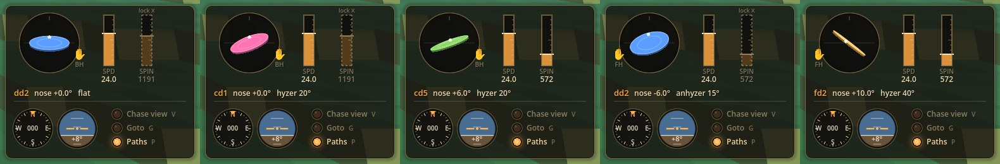

# Throw HUD rework (spec)

> **Status:** built (Oct 2026). Sketch: [mockups/throw-hud-sketch.png](mockups/throw-hud-sketch.png).
> Replaces the T throw panel. Controllers are out of scope for now.
> Code: `scripts/throw_setup.gd` (state + keys), `scripts/throw_hud.gd` (drawing), `scripts/dials.gd`, `scripts/lamps.gd`. Test: `tools/hud_test.gd`.

## HUD (one block, lower right)

- **Disc circle**: the disc drawn from behind, side on. Left/right tilt shows hyzer/anhyzer. Nose tips the disc the way you set it — **flat at 0, up for nose up, down for nose down** (drawn 1.8× steeper) — with a dot on the leading edge and the lit top face for nose up, the dark underside for nose down. A flat disc is therefore a thin bar, which is what edge-on looks like; the face opens up as you add nose. The status line under it reads `nose +3.0°  hyzer 20°`. Each disc has its own HUD colour.
- **✋ hand**: right of the circle = backhand, left = forehand.
- **Velocity bar** (left of the pair) and **spin bar** (right). Spin is dotted/dimmed and can't be changed while it's locked (auto spin from speed). The velocity bar reads **mph, 0–80** by default, because that is the range a disc golfer thinks in; **I** switches it to m/s for anyone who prefers it. The flight model works in m/s either way, and the step follows the unit on screen (1 mph, or 0.5 m/s), so the readout always moves in round numbers.

  The velocity bar is banded into **putt**, **midrange** and **drive**, marked
  `P` / `M` / `D` down its left edge with the one you are in lit, and named in
  words under the reading. The edges are 12 m/s (27 mph) and 21.5 m/s
  (48 mph), measured rather than guessed: over flat ground at nose +6 and 8°
  hyzer, a putter, a midrange and a driver all carry 18 m at the first edge
  and 51-55 m at the second. What a speed is worth in metres depends on the
  disc and the angle; which *kind* of throw it is for does not, which is why
  the bands can live on the dial. They are set in `throw_setup.gd`
  (`SPEED_BANDS`), so changing them moves the dial and the wording together.
- **Heading dial** and **horizon dial** below. They always show; the horizon chevron = launch angle (= view pitch, no offset).
- **Wind**, when there is any (F / Shift+F for strength, Z / Shift+Z to turn it): a pale blue arrow across the heading dial pointing the way the air is going, so it reads against your own heading (pointing down the dial = in your face). Its head and feathers stand outside the bezel, with only a faint shaft across the card, so the letters stay readable; it brightens with the gusts. Under the two dials, the wind you feel at head height, in the speed bar's unit, and how it sits against your throw: `wind 11 mph  head L→R`. Calm reads `wind calm`, dim.
- **Lamps**: Chase view (V), Goto (G), Paths (P), Shot circle (O), Aim arc (T).
- No readout under the crosshair: the horizon dial shows the launch angle (hide the HUD with U and there's nothing, on purpose).
- The **crosshair turns amber** when what it is on is inside putting range (20 m, circle 2): a throw now is lofted so the disc arrives at that point rather than setting off at it, and the softer you throw the more loft you get. If the speed you have dialled in cannot get there at any angle, the disc goes on the straight line and a note says "too soft to get there".

## Keys

| Key | Action |
|---|---|
| WASD | walk (arrows no longer walk) |
| Mouse | look, always. Aim = where you look; view pitch is the launch angle |
| Shift | stroll faster |
| Space | hop |
| Tab | crouch / stand (toggle) |
| ↑ / ↓ | nose up / down |
| ← / → | tilt: the edge on that side drops (backhand ← = hyzer; forehand mirrored) |
| Shift + ↑ / ↓ | velocity |
| Shift + ← / → | spin (only when unlocked) |
| X | spin lock / unlock |
| R | reset disc to flat (nose 0, hyzer 0) |
| H | backhand ↔ forehand |
| E / Q | next / previous disc (was Tab / Shift+Tab) |
| Left click / Enter | throw disc |
| Right click | throw orange cube (at the disc speed) |
| L | launch yourself with your last throw (disc or cube) |
| V | chase view toggle (discs + cubes) |
| G | goto toggle (was Z warp; discs + cubes) |
| P | paths + beams toggle |
| U | hide / show the whole HUD (and the help text) |
| - / = | HUD smaller / bigger (`--ui-scale=` at launch) |
| C | collect |
| ? | controls overlay (everything, keyboard + controller: [CONTROLS.md](CONTROLS.md)) |
| N | new world |
| K | clouds |
| F / Shift + F | wind stronger / lighter (calm, light, breezy, windy, strong, gale) |
| Z / Shift + Z | turn the wind 45° |
| Esc | free the mouse |

Removed: T (panel), J (horizon dial toggle), Z (now G), 1–0 cube power (cubes use the speed bar), launch offset, arrows-walk.

Everything carries over from throw to throw (practice!); R resets the tilt only.

## Size

The overlay is drawn 1× up to a 900 px tall window, then scaled in proportion (fullscreen 1800 px tall = 2×), times your own `- / =` adjustment. Err small, grow it if needed.

Tap vs hold on arrows: a tap nudges a fine step (0.5° nose, 1° hyzer, 1 mph, a few rad/s spin); holding ramps up.
